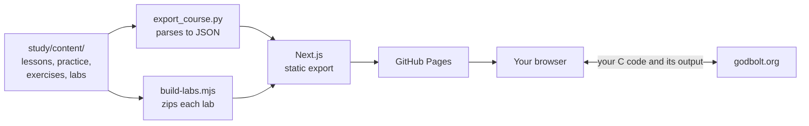

# High-Performance Systems Programming

[](https://github.com/idanhaitner/high-performance-systems-programming/actions/workflows/pages.yml)

An interactive study site that explains why some programs run fast and others run slow, starting from zero. You read short lessons, answer questions as you go, and write real C in the browser.

**[Open the site](https://idanhaitner.github.io/high-performance-systems-programming/)**

No prior C or systems knowledge is assumed. Every term is explained before it is used.

## What's in the course

The course has 2 lectures so far. Read a lecture's lessons first, then do its practice.

| | Lecture 1: Data, memory, and running programs | Lecture 2: Memory management |
| --- | --- | --- |
| **Lessons** | 8 | 6 |
| **Coding exercises** | 16 | 12 |
| **Lab** | Stride timing | Stack limit |

**Lecture 1 lessons**

1. Why the machine matters
2. Values and types
3. Memory and pointers
4. Printing and reading values
5. Working with strings
6. Structures
7. Programs and processes
8. Command-line arguments

**Lecture 2 lessons**

1. Pointers to pointers
2. Pointer arithmetic and pointer mistakes
3. Pointers to functions
4. Memory on request: `malloc` and `free`
5. Resizing memory and arrays of strings
6. Stack or heap?

## How you learn on the site

- **Lessons** explain one idea at a time, with figures and worked examples. Questions sit beside or inside the text.
- **Practice** walks through a lecture one step at a time: reasoning questions, small code questions, and larger exercises.
- **Coding exercises** open in an editor in the page. **Run** shows what your code prints, and **Submit** checks it against test cases. Hints and a full solution are there if you get stuck, and an **Assembly** tab shows the machine instructions the compiler made.
- **Labs** are downloaded as a zip and done on your own computer with `gcc` and `make`. Each one ends with a final exercise that uses the whole lecture.
- **Search and a glossary** let you look up any term.

Your progress is saved in your browser's local storage, so there is no account to create. It stays on that one browser and device.

> [!NOTE]
> The site has no server of its own. When you press **Run** or **Submit**, your code is sent to [godbolt.org](https://godbolt.org), a free website that runs the C compiler. The site cannot run exercises while that service is unreachable.

## Run it locally

You need:

- [Node.js](https://nodejs.org) 22 (the version CI uses)
- Python 3 (the content exporter uses only the standard library)
- `gcc` and `make`, only for checking exercises and doing the labs

```bash
git clone https://github.com/idanhaitner/high-performance-systems-programming.git
```

```bash
cd high-performance-systems-programming/study/web
```

```bash
npm ci
```

```bash
npm run dev
```

Then open <http://localhost:3000>.

## How it works

All the course content lives in plain text under `study/content/`. At build time, a small Python script turns it into JSON, and Next.js renders that JSON into a fully static site.



The stack:

- [Next.js](https://nextjs.org) 15 and React 19, built with `output: "export"`
- [Tailwind CSS](https://tailwindcss.com) 4
- [CodeMirror](https://codemirror.net) 6 for the code editor
- [clang-format](https://clang.llvm.org/docs/ClangFormat.html), compiled to WebAssembly, to tidy your code in the browser
- [Shiki](https://shiki.style) for code highlighting and [KaTeX](https://katex.org) for math
- [Vitest](https://vitest.dev) for unit tests, Python `unittest` for the exporter, and [Playwright](https://playwright.dev) for optional browser checks

## Repository layout

```text
study/
├── content/                 The course itself
│   ├── course.yml           Course outline, lecture summaries, changelog, glossary
│   ├── topics/              One Markdown file per lesson
│   ├── sessions/            One Markdown file per lecture's practice
│   ├── exercises/           Browser coding exercises, one folder each
│   └── labs/                Labs done on your own computer, one folder each
└── web/                     The Next.js site
    ├── app/                 Pages: home, lessons, practice, glossary
    ├── components/          Interface, with the practice workspace in session/
    ├── lib/                 Course loading, running code, progress, unit tests
    ├── public/              Figures and other static files
    └── scripts/             Content exporter, lab zipper, and checks
```

## Adding or changing content

Lessons and practice sessions are Markdown with a small header and `:::` blocks for the interactive parts:

| Block | Purpose |
| --- | --- |
| `:::definition` | A precise definition, after the plain explanation |
| `:::trap` | A common mistake to watch for |
| `:::check` | A multiple-choice question |
| `:::problem` | A longer question |
| `:::learn` | A reading step in a practice session |
| `:::exercise ref=<id>` | Places a coding exercise in a practice session |
| `:::lab ref=<id>` | Places a lab in a practice session |

A question looks like this. The `[x]` marks the right answer:

````markdown
:::check id=q-lost-one lesson=why-low-level
A `double` keeps only about 16 significant digits. What does this print?

```c
double total = 1e20;
total = total + 1.0;
total = total - 1e20;
printf("%.1f\n", total);
```

- [ ] `1.0`
- [x] `0.0`
- [ ] `100000000000000000000.0`
:::
````

A **coding exercise** is a folder in `study/content/exercises/` with four files:

| File | Purpose |
| --- | --- |
| `README.md` | The brief and its examples |
| `starter.c` | The bare function the reader starts from |
| `solution.c` | A finished answer |
| `test.c` | The test cases behind **Submit** |

A **lab** is a folder in `study/content/labs/` with a `README.md`, a `Makefile`, starter code, `tests/`, a `final/` exercise, and a `solution/` folder. The `solution/` folder is left out of the zip that readers download.

All content is written for someone starting from zero, so explain a word before you use it, and start from an everyday picture before the formal rule.

## Tests and checks

Run these from `study/web`. CI runs the first four on every pull request into `main`.

| Command | What it checks |
| --- | --- |
| `npm test` | Unit tests, including content rules such as questions that must stand on their own |
| `python3 -m unittest discover -s scripts/course-export -p 'test_*.py'` | The content exporter |
| `npm run check:exercises` | Compiles and runs every exercise's starter and solution, and every lab's solution |
| `npm run build` | Builds the full static site |

There are also browser checks that you run by hand. They need a dev server on port 8732 and a Playwright browser:

```bash
npx playwright install chromium
```

```bash
npx next dev -p 8732
```

Then, in a second terminal:

| Command | What it checks |
| --- | --- |
| `npm run check:landing` | The home page at several screen widths |
| `npm run check:motion` | Motion and card layout across the site |
| `npm run audit` | Page layout and figures at desktop and phone widths |

## Deployment

[`pages.yml`](.github/workflows/pages.yml) runs the tests and the build on every pull request and every push to `main`. A push to `main` also deploys `study/web/out` to GitHub Pages, so a merged change goes live once its run succeeds.
